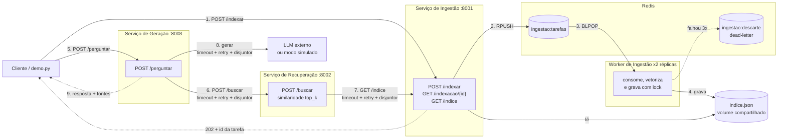

# FAESA - Sistemas Distribuídos (C2.A2)
## Sistema RAG Distribuído com Microsserviços, Mensageria e Resiliência

Este repositório contém a implementação do trabalho C2.A2 da disciplina de **Sistemas Distribuídos e Computação em Nuvem** da FAESA (2026/2, Prof. Howard Cruz Roatti). O projeto é uma arquitetura de **Geração Aumentada por Recuperação (RAG)** em três microsserviços desacoplados, com indexação assíncrona via fila Redis, mecanismos de resiliência (timeout, retentativa, circuit breaker, dead-letter) e validação ponta a ponta.

Os contratos HTTP e da fila entre os serviços estão em [docs/CONTRATOS.md](docs/CONTRATOS.md).

---

## Arquitetura e Fluxo de Dados



| Etapa | Comunicação | Por quê |
|---|---|---|
| Indexação (`/indexar` → worker) | **Mensageria** (fila Redis) | Vetorizar é lento; o cliente recebe `202` na hora e acompanha por `GET /indexacao/{id}`. Os workers escalam horizontalmente. |
| Pergunta (geração → recuperação → ingestão) | **REST síncrono** | O usuário espera a resposta; cada chamada tem timeout, retentativa e circuit breaker próprios. |
| Geração → LLM | **API HTTP externa** | Dependência lenta e instável, protegida por circuit breaker. Sem chave, usa o modo simulado (offline). |

O índice é um único arquivo JSON num volume compartilhado entre a API de ingestão (leitura) e os workers (escrita). A gravação é atômica (arquivo temporário + `os.replace`) e um lock distribuído no Redis (`ingestao:trava-indice`) impede que dois workers gravem ao mesmo tempo. A indexação é idempotente: um documento com o mesmo texto e origem de um já indexado é ignorado, então retentativas e reexecuções do `demo.py` não duplicam o índice.

---

## Estrutura do Projeto

```text
FAESA-SD-C2A2/
├── servicos/
│   ├── comum/
│   │   ├── circuit_breaker.py   # disjuntor (fechado / aberto / meio)
│   │   ├── embeddings.py        # vetorização TF-IDF offline
│   │   ├── fila.py              # fila Redis: tarefas, status, dead-letter e lock
│   │   ├── http_resiliente.py   # cliente REST com timeout, retry e disjuntor
│   │   ├── llm.py               # cliente do LLM com modo simulado
│   │   └── logging_utils.py     # logs em console e em logs/<servico>.log
│   ├── ingestao/                # API :8001, armazenamento.py, worker.py
│   │   ├── Dockerfile
│   │   └── Dockerfile.worker
│   ├── recuperacao/             # API :8002 (busca por similaridade) + Dockerfile
│   └── geracao/                 # API :8003 (LLM com circuit breaker) + Dockerfile
├── documentos/                  # base de teste (.txt) indexada pelo demo.py
├── docs/                        # contratos e evidências de validação
├── tests/                       # testes automatizados (unittest)
├── docker-compose.yml           # Redis, 3 serviços e worker com 2 réplicas
├── demo.py                      # demonstração ponta a ponta com métrica
├── requirements.txt
├── .env.example                 # modelo de configuração (sem chave)
└── TAREFAS.md                   # checklist do trabalho
```

As pastas `dados/` (índice) e `logs/` são criadas em tempo de execução e não são versionadas.

---

## Divisão de Tarefas e Integrantes

### 1. Tiago – Mensageria + Integração
* Criar o repo a partir do kit, convidar todos e definir os contratos.
* `POST /indexar` publica os documentos na fila Redis, e um worker de ingestão consome, vetoriza e salva (com retry + dead-letter).
* Revisar e aprovar os PRs, e integrar tudo na `main`.

### 2. Luis Felipe – Docker
* Um Dockerfile por serviço (ingestão, recuperação, geração, worker).
* `docker-compose` completo: Redis, os 3 serviços, worker com 2 réplicas, healthchecks, `depends_on`, volume para o índice e `.env`.

### 3. Eliã – Ingestão (Tarefa 1)
* Persistir o índice em disco (JSON no volume), para que ele não suma ao reiniciar.
* Corrigir o bug do `INDICE.clear()`, que apagava os documentos antigos a cada `/indexar`.
* Guardar e devolver a "origem" de cada documento (para citar as fontes).

### 4. Lucas – Recuperação (Tarefa 2)
* Implementar o `/buscar`: pegar o `/indice` da ingestão, vetorizar a pergunta, calcular `similaridade()` e devolver os `top_k` com score.

### 5. Daniel – Resiliência do LLM (Tarefa 3)
* Envolver o `gerar()` com o circuit breaker (`disjuntor.chamar`).
* Retentativa com backoff (3 tentativas) + tempo-limite.
* Circuito aberto devolve 503 com mensagem clara, e se o LLM falhar o sistema responde de forma degradada, sem quebrar.

### 6. Vinicius – Resiliência entre serviços + testes de falha
* Timeout + retentativa + disjuntor nas chamadas REST internas (geração → recuperação e recuperação → ingestão).
* Se um serviço estiver fora, devolver erro claro (503), sem estourar 500.
* Roteiro/script de testes de falha: simular quedas de serviços.

### 7. Davi – Fluxo ponta a ponta + README
* Script de demonstração (`demo.py`): indexa os arquivos validando o status do worker e faz perguntas extraindo fontes e métricas via campo `contexto`.
* Avaliação automática simples (cobertura lexical).
* Diagrama da arquitetura e README consolidado.

---

## Como Executar do Zero (Docker)

**Pré-requisitos:** Docker com Docker Compose 2.24+ e Python 3.11+ (para o `demo.py` e os testes).

### 1. Clonar o repositório
```bash
git clone https://github.com/tiagoarrigoni/FAESA-SD-C2A2.git
cd FAESA-SD-C2A2
```

### 2. (Opcional) Configurar o LLM real
Sem configuração nenhuma o sistema roda em **modo simulado**, totalmente offline. Para usar um LLM real, copie o modelo e preencha a chave (o `.env` é ignorado pelo Git; a chave **nunca** vai para o código):
```bash
cp .env.example .env      # Windows PowerShell: Copy-Item .env.example .env
# edite LLM_API_KEY (e, se quiser, LLM_API_URL / LLM_MODELO / LLM_TIMEOUT)
```

### 3. Subir a infraestrutura
```bash
docker compose up --build -d
docker compose ps
```
Sobem o Redis, a ingestão, a recuperação, a geração e **duas réplicas do worker**, compartilhando o volume do índice. Aguarde todos ficarem `healthy`.

### 4. Rodar a demonstração
No host, num ambiente virtual:
```bash
python -m venv .venv
# Windows:
.venv\Scripts\activate
# Linux/Mac:
source .venv/bin/activate

pip install -r requirements.txt
python demo.py
```

O `demo.py` envia cada arquivo de `documentos/` para `POST /indexar`, acompanha a tarefa em `GET /indexacao/{id}` até `pronto` (limite de 60 s por tarefa) e só então faz três perguntas em `POST /perguntar`. Para cada resposta, mostra as **fontes** (nomes dos arquivos) e a **cobertura lexical**: o percentual de palavras da resposta que aparecem no `contexto` recuperado. Essa métrica mede sobreposição de palavras, não a veracidade da resposta. Se a indexação falhar, o script termina com código 1 sem fazer perguntas. Pode ser executado mais de uma vez: documentos já indexados são ignorados.

### 5. Testar manualmente
```bash
curl -X POST http://localhost:8001/indexar -H "Content-Type: application/json" \
  -d '[{"texto":"O teorema CAP trata de consistencia e disponibilidade.","origem":"aula11"}]'
# devolve {"id": "...", "status": "na_fila", ...}; consulte até "pronto":
curl http://localhost:8001/indexacao/<id>

curl -X POST http://localhost:8003/perguntar -H "Content-Type: application/json" \
  -d '{"pergunta":"o que diz o teorema CAP?"}'
```
A documentação interativa (Swagger) de cada serviço fica em `http://localhost:800X/docs`.

### 6. Encerrar
```bash
docker compose down        # mantém o índice no volume
docker compose down -v     # apaga também o índice
```

---

## Execução Local sem Docker

Útil para depurar. É preciso um Redis em `localhost:6379`; o jeito mais simples é subir só ele pelo Compose (`docker compose up -d redis`). Com o ambiente virtual ativado e as dependências instaladas, abra um terminal por processo na raiz do repositório:

```bash
uvicorn servicos.ingestao.app:app     --port 8001
uvicorn servicos.recuperacao.app:app  --port 8002
uvicorn servicos.geracao.app:app      --port 8003
python -m servicos.ingestao.worker    # rode em 2 terminais para ver a divisão das tarefas
```

Fora do Docker o `.env` não é lido automaticamente: sem variáveis definidas, valem os padrões de `localhost` e o modo simulado do LLM. Para usar o LLM real, defina `LLM_API_KEY` no ambiente do processo da geração (PowerShell: `$env:LLM_API_KEY = "..."`). Depois rode `python demo.py`.

---

## Endpoints

| Serviço | Método e rota | Resposta |
|---|---|---|
| Ingestão :8001 | `POST /indexar` | `202` com id da tarefa · `400` lista ou texto vazio · `503` Redis fora |
| | `GET /indexacao/{id}` | `na_fila`, `processando`, `pronto` ou `falhou` · `404` id inexistente |
| | `GET /indice` | documentos indexados com origem e vetor |
| | `GET /saude` | total de documentos e estado da fila |
| Recuperação :8002 | `POST /buscar` | `top_k` trechos com `score` · `503` ingestão fora |
| Geração :8003 | `POST /perguntar` | `resposta`, `fontes`, `contexto`, `degradado` · `422` pergunta vazia · `503` dependência fora ou disjuntor aberto |
| | `GET /saude` | estado do disjuntor do LLM |

Detalhes e exemplos de JSON em [docs/CONTRATOS.md](docs/CONTRATOS.md).

---

## Resiliência e Tratamento de Falhas

### Indexação (mensageria)
* **Desacoplamento:** `POST /indexar` só enfileira; quem envia não espera a vetorização.
* **Retentativa no worker:** até 3 tentativas por tarefa, com espera crescente.
* **Dead-letter:** após a 3ª falha a tarefa vai para `ingestao:descarte` e o status fica `falhou`; o cliente nunca espera para sempre.
* **Lock distribuído:** com 2+ workers, só um grava o índice por vez.
* **Redis fora:** `POST /indexar` e `GET /indexacao/{id}` devolvem `503`; o worker espera e tenta de novo sem cair; `GET /indice` continua lendo o disco, então as perguntas continuam funcionando.

### Chamadas REST entre serviços
As chamadas `geração → POST /buscar → recuperação` e `recuperação → GET /indice → ingestão` usam o cliente compartilhado em `servicos/comum/http_resiliente.py`.

| Proteção | Comportamento |
|---|---|
| Timeout de conexão/leitura por tentativa | ingestão: 1 s / 2 s; recuperação: 1 s / 12 s |
| Retentativa | até 3 tentativas, incluindo a primeira |
| Backoff exponencial | espera de 0,2 s e 0,4 s entre tentativas |
| Falhas repetidas | conexão, timeout e HTTP 429, 500, 502, 503, 504 |
| Circuit breaker | abre após 3 consultas consecutivas malsucedidas (cada uma já com as tentativas esgotadas) |
| Recuperação do circuito | após 20 s, admite uma consulta de teste; sucesso fecha, falha reabre |
| HTTP 503 | conexão, timeout, erro HTTP, JSON inválido, resposta fora do contrato ou circuito aberto |

Cada dependência tem seu próprio circuito, em memória, por processo. Os 12 s de leitura na chamada à recuperação permitem que ela termine as próprias tentativas de acesso à ingestão (até cerca de 9,6 s). O cliente só é usado em consultas seguras de repetir (`GET /indice`, `POST /buscar`), nunca em `POST /indexar`. Tentativas, pausas e falhas ficam em `logs/http_resiliente.log`, sem gravar perguntas ou documentos.

### LLM
* **Timeout** configurável por `LLM_TIMEOUT` e **3 tentativas** com backoff de 0,5 s e 1 s.
* **Circuit breaker** (`disjuntor`, separado dos circuitos REST): abre após 3 consultas malsucedidas e admite uma sondagem após 20 s.
* **Degradação graciosa:** enquanto o circuito está fechado, uma consulta que esgota as tentativas devolve `200` com `degradado: true`, texto de contingência, `fontes` e `contexto`. A consulta que abre o circuito e as seguintes devolvem `503` até a sondagem.
* **Offline:** sem `LLM_API_KEY`, o modo simulado monta a resposta a partir do contexto recuperado.

---

## Testes

### Automatizados
Com o ambiente virtual ativado, na raiz do repositório:
```bash
python -m unittest discover -s tests -v
```
São 39 testes que não exigem Redis, Docker, chave de API, pytest ou httpx. Cobrem persistência do índice, indexação idempotente do worker, busca por similaridade, timeout, retry/backoff, concorrência do circuit breaker, falhas HTTP reais entre serviços em portas temporárias (503, propagação, abertura e recuperação dos circuitos), contingência e recuperação do LLM, validação de entrada e o contrato da demonstração.

### Roteiro de falhas com Docker
Com o sistema no ar e o índice populado pelo `demo.py`:

1. **Recuperação fora:** `docker compose stop recuperacao`. Faça 4 perguntas em `/perguntar`: as três primeiras devolvem `503` depois das retentativas, e a quarta devolve `503` na hora (circuito aberto, sem novas tentativas). Volte com `docker compose start recuperacao`, aguarde 21 s e pergunte de novo: `200`.
2. **Ingestão fora:** `docker compose stop ingestao`. `POST /buscar` e `POST /perguntar` devolvem `503` com `detail` indicando a dependência. Religue com `docker compose start ingestao`, aguarde 21 s: `200` sem reiniciar os outros serviços.
3. **Redis fora:** `docker compose stop redis`. `POST /indexar` devolve `503`, mas `POST /perguntar` continua respondendo (o índice está em disco). Religue com `docker compose start redis`.
4. **Worker fora:** `docker compose stop worker`. `POST /indexar` continua devolvendo `202` e a tarefa fica `na_fila`; ao religar (`docker compose start worker`), ela é processada.
5. **Persistência:** `docker compose restart ingestao worker` e confira em `GET /saude` que o total de documentos se manteve.

Acompanhe os logs com `docker compose logs -f geracao recuperacao worker`.

### Roteiro de falhas local (PowerShell)
Com os serviços rodando localmente (seção anterior), defina a função abaixo, que mostra o código HTTP e o corpo mesmo quando o PowerShell 5 recebe um erro:

```powershell
function Consultar-API([string]$Url) {
    $body = @{ pergunta = "O que diz o teorema CAP?" } | ConvertTo-Json
    try {
        $r = Invoke-WebRequest -UseBasicParsing -Uri $Url -Method POST `
            -ContentType "application/json" -Body $body
        [PSCustomObject]@{ status = [int]$r.StatusCode; corpo = $r.Content }
    } catch {
        $r = $_.Exception.Response
        if ($null -eq $r) { throw }
        $leitor = New-Object System.IO.StreamReader($r.GetResponseStream())
        try {
            [PSCustomObject]@{ status = [int]$r.StatusCode; corpo = $leitor.ReadToEnd() }
        } finally { $leitor.Dispose() }
    }
}
```

1. Com tudo ligado e sem `LLM_API_KEY`, `Consultar-API "http://localhost:8003/perguntar"` devolve **200** com resposta simulada.
2. Pare a recuperação (`Ctrl+C` no terminal da porta 8002) e rode `1..4 | ForEach-Object { Consultar-API "http://localhost:8003/perguntar" }`: as três primeiras devolvem **503** após as tentativas e a quarta é recusada pelo circuito. Confira com `Get-Content logs\http_resiliente.log -Tail 20` (`ConnectionError` vs. `CircuitoAberto`).
3. Religue a recuperação, aguarde 21 s e consulte de novo: **200**.
4. Pare a ingestão e rode `1..4 | ForEach-Object { Consultar-API "http://localhost:8002/buscar" }` e `Consultar-API "http://localhost:8003/perguntar"`: **503** nos dois, com `detail` indicando a dependência.
5. Religue a ingestão, aguarde 21 s e repita: **200**, sem reiniciar os consumidores.

### Evidências
* [docs/VALIDACAO_RESILIENCIA.md](docs/VALIDACAO_RESILIENCIA.md): resiliência HTTP com serviços reais (22/10/2026).
* [docs/VALIDACAO_INTEGRACAO.md](docs/VALIDACAO_INTEGRACAO.md): integração completa, falhas de ingestão, recuperação, Redis e LLM, e o fluxo do `demo.py` com fila e worker (26 e 28/10/2026).

---

## Decisões de Arquitetura

* **Três serviços com responsabilidade única:** ingestão (escrita do índice), recuperação (leitura e ranking) e geração (orquestração e LLM). Cada um escala e falha de forma independente.
* **Fila só na indexação:** é a etapa lenta e que não precisa de resposta imediata. A pergunta continua síncrona porque o usuário espera a resposta.
* **Disponibilidade em vez de consistência forte (CAP):** se o Redis cair, a leitura do índice continua funcionando; se o LLM cair, o usuário recebe as fontes em modo degradado. Um documento recém-enviado só aparece nas buscas depois que o worker termina (consistência eventual, acompanhada por `GET /indexacao/{id}`).
* **Circuit breaker por dependência:** uma falha no LLM não abre o circuito da recuperação e vice-versa; um serviço fora deixa de receber tráfego até a sondagem, o que evita falhas em cascata.
* **Configuração por variável de ambiente:** URLs, Redis e chave do LLM vêm do ambiente (`.env` no Compose); a chave nunca fica no código.
